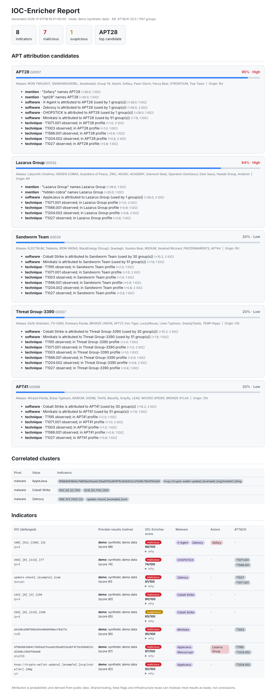

# IOC-Enricher

Python IOC-enrichment and **APT-attribution** tool. It enriches threat indicators (IPs, domains, URLs, hashes) from multiple intel sources, correlates them into clusters, and ranks likely threat actors with an **explainable, evidence-based score** built on MITRE ATT&CK and MISP Galaxy.



## Features

- **Multi-source enrichment**: VirusTotal, AbuseIPDB, Shodan, AlienVault OTX, abuse.ch (ThreatFox, URLhaus, MalwareBazaar). Providers without an API key are skipped automatically.
- **IOC handling**: auto-detects type, accepts defanged input (`hxxp://evil[.]com`), extracts IOCs from free text (reports, emails, logs), defangs output.
- **Correlation**: clusters indicators that share a malware family, named actor, ASN or org, which helps spot a single campaign across indicators.
- **APT attribution**: ranks ATT&CK groups (1,100+ with MISP aliases) with per-candidate evidence.
- **I2A investigations**: recursive infrastructure pivoting, role assessment, interactive graph and evidence-based actor hypotheses (see below).
- **Reports**: self-contained HTML (dark/light, XSS-safe) plus machine-readable JSON.
- **Practical**: SQLite response cache, free-tier rate limiting, offline `--demo` mode, tests and CI.

## Quick start

```bash
pip install -e ".[dev]"
ioc-enricher enrich -f examples/sample_iocs.txt --demo      # no API keys needed
cp .env.example .env                                        # add keys for live mode
ioc-enricher enrich -i 'hxxp://bad[.]example/x' -i 203.0.113.9 -o out
ioc-enricher update-kb                                      # refresh ATT&CK + MISP data
```

`--demo` uses **synthetic** data (RFC 5737 IPs, example TLDs, fake hashes) to show the pipeline. It does not describe real infrastructure.

## I2A investigation: IOC to Infrastructure to Actor

`enrich` answers *"is this indicator bad?"*. `investigate` follows a graph-based CTI methodology and answers three questions per seed IOC:

1. **What is this IOC?** Reputation from every source, shown natively, plus the IOC-Enricher score, first-observed date and role hypotheses.
2. **What is it connected to?** Related domains, IPs, certificates, samples and shared infrastructure, found by recursive pivoting. Every link records *how we know it*.
3. **Who might be behind it?** Ranked actor hypotheses with evidence per dimension, alternatives, and a hedged analyst statement.

```bash
ioc-enricher investigate --demo -f examples/i2a_seeds.txt          # offline, synthetic network
ioc-enricher investigate -i 203.0.113.9 --depth 2 -v               # live (uses the keys you have)
ioc-enricher investigate -i hxxp://bad[.]example/x --pivots crtsh,urlscan
```

Output: `out/i2a_report.html` (three-question cards, intelligence table, defensive actions, interactive graph) and `out/i2a_report.json`.


### Pipeline

| Stage | What happens |
|---|---|
| 1. Context | Seeds are enriched by the reputation providers. A URL or e-mail seed is pivoted through its host or domain. |
| 2. Infrastructure pivoting | IP to domains (passive DNS, urlscan, Censys), domain to IPs, domain to certificates to sibling domains (crt.sh), sample to contacted hosts (VirusTotal), TLS-fingerprint look-alikes (FOFA JARM). Depth 2 by default. |
| 3. Role assessment | Nodes are labelled `c2-candidate`, `payload-host`, `shared-infrastructure`, `shared-certificate` or `dns-behaviour`, each with its evidence. Confidence never exceeds Moderate because nothing here inspects beaconing or malware configs. Linked nodes are clustered. |
| 5. Actor assessment | Weighted attribution over the whole cluster (see below). |

Stage 4 of the methodology (sandbox and campaign correlation) is represented by malware families, campaign names and ATT&CK techniques that the sources report. Direct sandbox integrations (ANY.RUN, Hybrid Analysis) are not included yet.

### Evidence types on every edge

- **observed**: read directly from a source (a DNS record, a certificate, a scan result).
- **inferred**: derived by this tool, such as a shared TLS fingerprint. Weaker.
- **reported**: asserted by a third-party report or label.

Each edge also carries its source, a reliability weight, first/last seen dates and a link back to the source.

### Guard rails against graph explosion

- A node's **path weight** is the product of edge weights from the seed. Nodes below `--min-weight` (0.25) are shown but not expanded, so weak and distant pivots fade out.
- `--fanout` caps new nodes per pivot, and `--max-nodes` caps the whole graph.
- An IP serving more than 40 domains is flagged **shared infrastructure** and its domains are not added. Nodes in CDN/cloud ASNs are treated the same way.
- Mega-domains (Google, Microsoft, CDNs...), multi-tenant certificates (more than 40 names) and private IPs are ignored. **Private IPs are never sent to any external source.**
- A shared IP, certificate or hosting provider is a lead, not proof of common control.

### How the actor assessment differs from a label lookup

Evidence is grouped by dimension: `reported` (a label on the seed itself), `infrastructure` (a label on linked infrastructure), `malware` (rarity-weighted tool overlap) and `ttp`. **A label alone can never reach High**: that needs two independent dimensions. `victimology` and `operational` behaviour are shown as *not assessed* because no source here provides them. Evidence reached through a weak path counts proportionally less, and commodity-tool overlap is capped at Low. Confidence uses Low / Moderate / High, and the report always lists alternative hypotheses and the limitations. A "confirmed association" is never produced automatically, because that needs human analysis.

### Sources and keys

| Source | Used for | Key |
|---|---|---|
| crt.sh | certificates and SANs | none |
| urlscan.io | page and IP history, redirects, contacted domains | optional `URLSCAN_API_KEY` |
| VirusTotal relationships | passive DNS, communicating files, sandbox contacts | `VT_API_KEY` (free tier is slow: 4 requests/min) |
| Censys Platform API | services, certificates, ASN, reverse DNS, same-certificate hosts | `CENSYS_API_TOKEN` |
| FOFA | domains, services, JARM fingerprint look-alikes | `FOFA_API_KEY` |

> **Verify before relying on it:** the pivot providers are unit-tested against mocked responses only. Censys does not publish every response field name, so its parser accepts several layouts. Check each source once with your own key.

## How each indicator is scored

Every provider's result is shown **in its own native terms** (for example `62/72 engines malicious`, `abuse confidence 87%`, `7 pulse(s)`), never rewritten. The tool's own **IOC-Enricher score** is shown separately:

1. Each provider's result is mapped to 0-100 internally (VirusTotal from engine detections, AbuseIPDB its confidence score, ThreatFox its confidence, OTX 15 per pulse, URLhaus 90 if listed, MalwareBazaar 95 if found). Shodan is context only and gives no score.
2. Score = highest provider signal, plus 5 for each additional provider scoring 50 or more, capped at 100.
3. Verdict: 70+ malicious, 30-69 suspicious, below 30 clean, no usable score unknown. The thresholds are `MALICIOUS_AT` / `SUSPICIOUS_AT` in `engine.py`.

"Clean" means no queried source flagged the indicator. It does not mean safe. The report's *why* panel shows exactly how each score was derived.

## How attribution works

Per candidate group, evidence is summed then squashed to 0-100 (`100 * (1 - e^(-raw/55))`):

| Signal | Weight | Notes |
|---|---|---|
| Direct mention | 30 (x1.3 if from an adversary field) | Group name or alias in an adversary field, tag or pulse title. Word-boundary matching, so `apt10` does not match `APT1`. |
| Software | up to 28 | Malware/tool attributed to the group in ATT&CK, **rarity-weighted** (X-Agent used by 1 group scores about 28; Mimikatz used by about 50 scores about 8). |
| Technique | about 1-2 each, capped at 16 | Overlap of ATT&CK IDs. Can never create a candidate alone. |

**Guard rails**: with no direct mention and fewer than two rare software matches, confidence is capped (Moderate for one rare family, Low for commodity-only overlap such as Cobalt Strike + Mimikatz). Every score lists its evidence and the IOCs behind it.

> Attribution is probabilistic. Shared tooling, false flags and infrastructure reuse can mislead. Treat output as analyst leads, not conclusions.

## Layout

```
ioc_enricher/
  ioc.py            parsing, refang/defang, extraction
  providers/        one class per source, normalised ProviderResult
  engine.py         enrichment, verdicts, correlation
  attribution/      knowledge base builder + weighted scorer
  report.py         JSON + HTML output
  data/groups.json  bundled ATT&CK + MISP snapshot
tests/              pytest suite
```

## Adding a provider

Subclass `Provider`, set `name`, `env_var`, `supported`, implement `_lookup()` returning a `ProviderResult`, and register it in `providers/__init__.py`.

## Responsible use

Intended for defensive security work. Respect each provider's terms and rate limits (free tiers are throttled by default). Do not submit sensitive or internal indicators to third-party services without authorisation.

## Data sources

See [NOTICE](NOTICE) for data attribution. The bundled knowledge base is derived from MITRE ATT&CK (c) The MITRE Corporation, used under the ATT&CK Terms of Use, and the MISP Galaxy threat-actor cluster. Use of each third-party API is subject to that provider's terms. This project is MIT licensed.

## Project status and testing

- 45 automated tests (`python -m pytest -q`) cover parsing, scoring, attribution dimensions, guard rails, report escaping, and every provider and pivot source against mocked API responses.
- `--demo` and `investigate --demo` run fully offline on **synthetic** data.
- Live integrations are written against each provider's documentation. Check each one with your own API key before relying on it, and see the testing steps in this README's history. Censys' response layout is parsed defensively because its field names are not fully documented.
- No claim is made about attribution accuracy until you have measured it on your own labelled cases.
